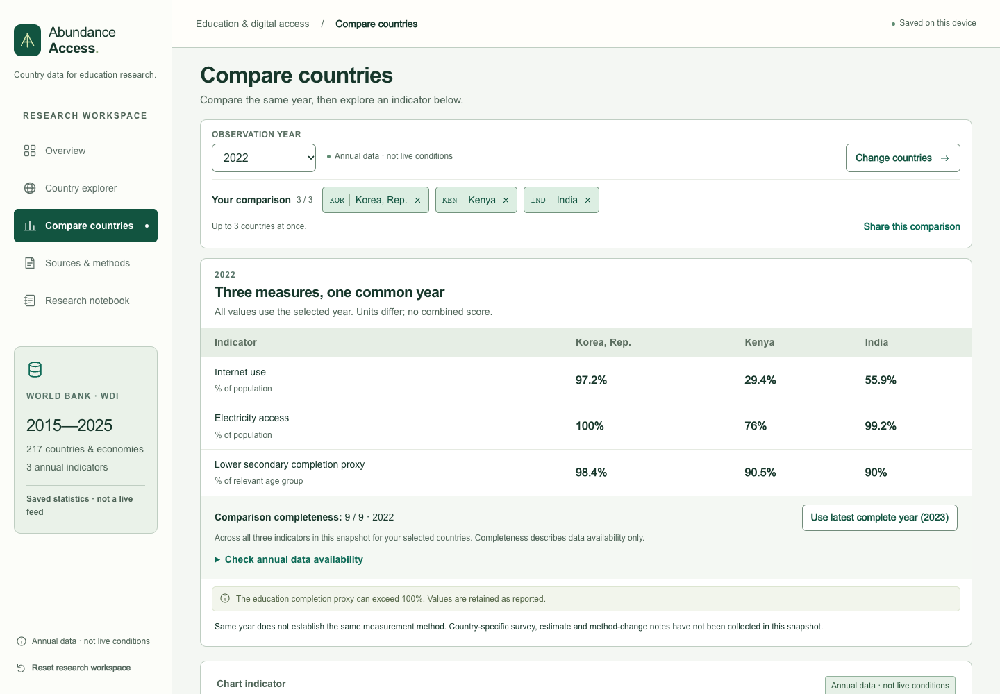

# Abundance Access

[Live dashboard](https://tomatopepperoni.github.io/abundance-access/) · [Source](https://github.com/tomatopepperoni/abundance-access) · [한국어 설명](README.ko.md)

A static dashboard and a separate local, read-only MCP server for comparing national education and digital access conditions.

**Question:** Even when online education is free, how do the basic conditions for using it differ between countries?

The intended users are researchers and nonprofit teams planning follow-up investigation. This prototype supports comparison, source inspection and research notes. It does not select a country for an intervention or predict educational, employment or income outcomes.

An independent personal project inspired by a supply-chain class taught by Yorke Rhodes. He did not create, commission or endorse this tool.



## Try the comparison

Choose **Try Korea, India and Kenya (2022)** on the overview, or select other countries in the map/search table. Compare up to three countries using one common year. The table shows all three indicators; **Chart indicator** changes the adjacent chart and historical series. Check definitions and missing values before recording observations and follow-up questions.

Selections and notes stay in browser storage. Drafts retain the country, year, indicator and snapshot recorded when writing began, even after filters change. Storage failures show **Session only**. CSV and Markdown exports keep comparison and note contexts separate.

**Share this comparison** creates a validated link containing the countries, reference year, chart indicator and snapshot ID. It never includes your notes. Recipients reproduce the selection and values while the same snapshot is available. A link to another snapshot requires an explicit choice to use the currently available data; it does not retrieve archived values. Opening a shared selection preserves existing drafts and saved notes.

**Use latest complete year** finds the most recent year in the included snapshot with all three indicators reported for every selected country. Availability is shown for each year; completeness does not establish methodological comparability. Missing values are never filled, and year changes require a click.

**Calculated observations** shows signed same-year differences for the chart indicator in percentage points, using full source precision. It makes no ranking or causal claim. Transfer calculations and their source rows into a notebook draft, add your observations/questions separately, and save. Recorded evidence stays fixed when filters change. Conflicting unfinished drafts are preserved and opened for review. CSV and Markdown exports retain the calculation context, source URLs and raw references. [Example recorded evidence note](docs/recorded-calculation.png).

**Choose what to investigate next** connects the comparison to a short plan about connection costs, device access, power reliability or learning support. Record the intended learners, locality, evidence needed, source to check, your investigation status and the decision it would inform. Starting a plan from a comparison retains the calculated evidence separately. These fields start blank; the dashboard does not invent local evidence or findings. Existing drafts and plans are preserved, and a new plan never silently replaces them.

[Illustrative investigation plan](docs/investigation-plan.png) — the text shown is a workflow example, not collected local evidence.

**Export scope** defaults to **Current comparison only**, excluding all drafts, notes and plans. **Comparison + matching notes** includes only records with exactly the same country set, year, focused indicator and snapshot. **Entire workspace** explicitly includes unrelated records, unassigned legacy drafts and older snapshots. The preview counts and file metadata state the selected scope. Status labels such as **Reviewed by you** are the user's assessment, not verification by this tool.

For example, a researcher can record Kenya's reported 2022 internet-use value, choose **Connection costs**, and plan to check a named community's tariffs and device availability before considering course delivery options. This is an illustrative investigation workflow, not collected local evidence or a recommendation to operate in Kenya.

## Data and provenance

The included World Bank WDI snapshot contains **217 countries/economies**, **three indicators**, and **2015–2025**: 7,161 country–indicator–year records, including **5,359 reported values** and **1,802 missing records**. Another 79 regional, income-group and world aggregates are kept separate from the country list.

| Indicator           | Original provider                     | What it describes                                         |
| ------------------- | ------------------------------------- | --------------------------------------------------------- |
| `IT.NET.USER.ZS`    | International Telecommunication Union | Individuals using the Internet, % of population           |
| `EG.ELC.ACCS.ZS`    | World Bank / ESMAP                    | Access to electricity, % of population                    |
| `SE.SEC.CMPT.LO.ZS` | UNESCO Institute for Statistics       | Lower-secondary completion proxy, % of relevant age group |

World Bank is the distributor; it is not treated as the original provider for every series. Definitions, methodology, provider attribution and source links are in [indicator metadata](src/content/indicators.json).

- Snapshot collection completed: **2026-11-05 00:19:55.765 UTC** — November 4 in New York.
- Manual metadata review: **2026-11-04**. Collection and link checks do not update this review date.
- These are **annual observations, not a live feed**. Retrieval time and statistical reference year are distinct.
- Raw API responses, request URLs, retrieval timestamps and hashes are retained. Validation compares normalized observations with their raw rows; it does not independently prove that source statistics are correct.
- **Open saved raw response** links to a verified, fixed Git commit rather than the changing API response. The response SHA-256 and zero-based `response[1][index]` identify the preserved record. This index is not a file line number. Unknown or older unregistered snapshots do not receive current-snapshot archive links. After publishing a new collection, independently check its committed raw files/hashes before adding its revision in `src/lib/provenance.ts`.
- Same-year completeness only describes availability. Country-specific survey, estimation and method-change notes have not been collected; national values are not automatically methodologically equivalent. The school completion proxy is background on school-age education, not adult learning readiness.

## Run locally

Use Node.js **22.12+** and npm.

```sh
npm ci
npm run dev
```

Open `http://127.0.0.1:5173/`. The dashboard reads the bundled snapshot and needs no login, API key, server or LLM call. Vite uses relative assets and hash navigation for GitHub Pages repository subpaths.

```sh
npm run check                 # Types, data integrity, unit tests, MCP communication, build
npx playwright install chromium
npm run test:e2e              # Desktop/mobile browser flows and accessibility checks
```

Local verification covered 51 unit tests and 48 desktop/mobile browser cases, including filters, missing data, map/table agreement, note context, storage failures, exports, keyboard use and subpath reloads. This is code verification, not validation of external statistics or every real device/screen-reader combination.

## Query the same data through MCP

The MCP server uses **stdio locally**, separately from the public website. It queries the collected snapshot through the same [query module](src/lib/query.ts) as the dashboard; tool calls do not fetch newer statistics.

```sh
npm run mcp:demo              # Real MCP client: Korea, India, Kenya in 2022
npm run mcp:demo -- 2021       # Another allowed reference year
npm run test:mcp              # Handshake, tools/list, tools/call and input rejection
node --import tsx scripts/mcp-config.ts # Print this checkout's host configuration
npm run mcp                  # Start the local stdio server
```

Available tools: `list_countries`, `get_indicator_metadata`, `get_country_metrics`, `compare_countries`. Inputs validate country codes, allowed indicators and years. Results include values, units, reference years, provenance, collection timestamps and missing status. The server has no write tools and does not invent causes or policy effects. Host setup details are in the [Korean README](README.ko.md#로컬-mcp-서버).

## Inspect or reproduce the implementation

| Concern                                           | Source                                                                                                    |
| ------------------------------------------------- | --------------------------------------------------------------------------------------------------------- |
| Collection, timeouts, retries and pagination      | [collector](scripts/collect-data.ts), [World Bank adapter](scripts/world-bank.ts)                         |
| Schema, missing states and relationships          | [schema](src/lib/schema.ts)                                                                               |
| Raw hashes and row-by-row integrity checks        | [validator](scripts/validate-data.ts), [raw responses](data/raw/), [snapshot](data/snapshots/latest.json) |
| Shared dashboard/MCP lookup                       | [query module](src/lib/query.ts), [MCP server](mcp/server.ts)                                             |
| MCP client example and communication verification | [demo](scripts/demo-mcp.ts), [tests](scripts/test-mcp.ts)                                                 |
| Notes, migration and export contexts              | [research state](src/lib/research.ts), [exports](src/lib/export.ts)                                       |
| Regression checks                                 | [unit tests](tests/unit/), [browser tests](tests/e2e/)                                                    |

Run `npm run data:fetch` to collect a new official snapshot, then `npm run validate:data` and `npm run build`. The collector preserves raw responses and produces success/failure reports. Missing values remain missing; they are not replaced with zero or carried forward.

GitHub Actions run CI on pushes and pull requests. Pages deployment and data collection are manual. A weekly/manual link check records HTTP status reports without changing content or treating 403, 429 or transient failures as deleted sources. A successful link request does not verify the linked content's accuracy.

The [earlier implementation and review record](docs/improvement-review-2026-11-05.json) and [follow-up research workflow prompt and checks](docs/research-workflow-improvement-2026-11-05.json) document the changes. Reviews use evidence and reproducibility criteria informed by the published course description; they are not a review or endorsement by Professor Rhodes. The connection to the class is applying provenance and evidence-handling principles to education-access research; this dashboard does not trace commercial supply chains.

## Interpretation and limits

Observed statistics and user-authored notes are distinct from the project's research prompts. Those prompts are fixed questions, not country-specific findings or causal analysis. There is no composite education score or country ranking.

Internet use does not directly measure online learning access, connection affordability, speed or device ownership. Electricity access does not establish reliability. The education series is a gross intake-based completion proxy; it can exceed 100% and does not measure teaching quality or individual readiness. National averages can conceal local, gender, income and accessibility differences. The snapshot does not include connection costs, device access or these disaggregated conditions.

Development used AI coding assistance. The repository exposes the implementation, data provenance, design choices and tests so they can be inspected and reproduced; it does not claim that code was written without AI or that automated checks replace subject-matter review.

## Licensing

The three World Bank metadata records identify their series as **CC BY 4.0**, subject to the [World Bank dataset terms](https://www.worldbank.org/ext/en/legal/terms-conditions/datasets). Retain both distributor and original-provider attribution and review exceptions before adding data. Map boundaries are Natural Earth, [public domain](https://www.naturalearthdata.com/about/terms-of-use/); [map provenance](data/map-provenance.json) records the source and transformation. Boundaries are for statistical navigation, not a sovereignty claim.

These data terms do not license this project's code. A project code license has not been selected.
